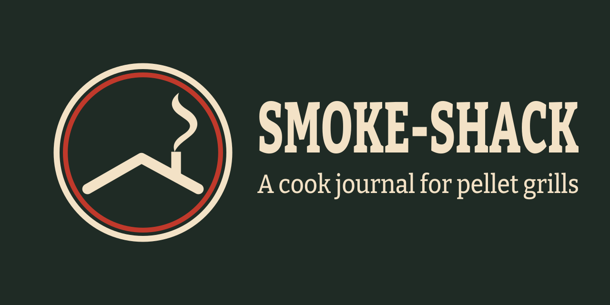

<p align="center">
  
</p>

# Smoke-Shack

Smoke-Shack is a self-hosted cook journal for pellet grills. It records grill and probe data
from Home Assistant, turning each cook into a searchable history of temperatures, phases,
events, ingredients, notes, and results. It was built and tested with a Green Mountain Grills
Daniel Boone Prime WiFi through the `gmg-ha` integration. Smoke-Shack only reads from Home
Assistant and never controls the grill.

## Status

Smoke-Shack is an early release. The author uses it daily with one grill, but expect rough
edges.

## Features

- Cook log with raw temperature history, cook details, photos, and CSV or JSON exports
- Live view of pit temperature, setpoint, food probes, targets, and grill status
- Automatic startup, cook, and cool-down phases, plus automatic and user-pinned events
- Custom meat groups and cohort statistics across comparable cooks
- Pantry for meat, pellets, and spice rubs
- Notes attached to a cook, pellets, or gear
- Ask the Pitmaster filters for cook-time averages, ranges, and time per pound
- Downloadable and shareable cook cards with photos, results, notes, phases, and charts

## How it works

The grill connects over Wi-Fi to the `gmg-ha` integration inside Home Assistant. Home
Assistant then provides the grill data to Smoke-Shack. Smoke-Shack does not talk to the grill:
it only reads from Home Assistant through its REST API and WebSocket connection, then records
each cook in its own SQLite database.

## Requirements

1. **Home Assistant**, running and reachable from the Smoke-Shack container, with a
   [long-lived access token](https://www.home-assistant.io/docs/authentication/#your-account-profile).
2. **The [`gmg-ha` integration](https://github.com/y3klab/gmg-ha)**, installed in Home
   Assistant through [HACS](https://www.hacs.xyz/). The grill must be in Wi-Fi mode and
   reachable on the local network because `gmg-ha` communicates with it over local UDP, with
   no cloud service. Smoke-Shack was built and tested with a Green Mountain Grills Daniel
   Boone Prime WiFi; other grills are untested.

   Credit goes to the `gmg-ha` project and its author for the Home Assistant integration.
3. **Docker with Docker Compose**.

Other Home Assistant grill integrations may work if you map their entities in
`entities.yaml`, but only `gmg-ha` is tested.

## Quick start with Docker Compose

Create `compose.yml` and replace `<image>`, the Home Assistant host, token, and grill name
with values for your installation:

```yaml
services:
  smoke-shack:
    image: <image> # Replace with the Smoke-Shack image you want to run.
    restart: unless-stopped
    ports:
      - "8000:8000"
    environment:
      HA_URL: http://home-assistant-host:8123
      HA_TOKEN: replace-with-a-long-lived-access-token
      DATABASE_PATH: /data/smoke-shack.db
      PHOTO_DIR: /data/photos
      ENTITIES_CONFIG: /app/config/entities.yaml
      SMOKE_SHACK_GRILL_NAME: My Pellet Grill
      TZ: America/Los_Angeles
    volumes:
      - smoke-shack-data:/data
      - ./config/entities.yaml:/app/config/entities.yaml:ro

volumes:
  smoke-shack-data:
```

The `<image>` placeholder will be replaced with a published image reference once images are
available. Until then, build the image from this repository with
`docker build -t smoke-shack .` and use `smoke-shack` as the Compose `image` value.

Copy [`config/entities.yaml`](config/entities.yaml) next to the Compose file, edit it as
described below, then start the app:

```sh
docker compose up -d
```

Open `http://docker-host:8000`. Keep the Home Assistant token out of version control; a
Compose `.env` file or your container platform's secret storage is preferable to committing
it in the Compose file.

## Configure Home Assistant entities

`ENTITIES_CONFIG` tells Smoke-Shack where to find the YAML entity map. The included
[`config/entities.yaml`](config/entities.yaml) uses the entity IDs that `gmg-ha` creates in a
default installation:

```yaml
pit_climate: climate.green_mountain_grill
pit_temp: sensor.green_mountain_grill_temperature
probe1_temp: sensor.green_mountain_grill_probe_1_temperature
probe2_temp: sensor.green_mountain_grill_probe_2_temperature
probe1_connection: binary_sensor.green_mountain_grill_probe_1_connection
probe2_connection: binary_sensor.green_mountain_grill_probe_2_connection
probe1_climate: climate.green_mountain_grill_probe_1
probe2_climate: climate.green_mountain_grill_probe_2
fire_state: sensor.green_mountain_grill_fire_state
power_state: sensor.green_mountain_grill_power_state
warning: sensor.green_mountain_grill_warning
extra_probes: []
```

Each value is a Home Assistant entity ID:

- `pit_climate`: the grill climate entity; supplies the operating mode and pit setpoint.
- `pit_temp`: the current pit temperature sensor.
- `probe1_temp` and `probe2_temp`: the current food-probe temperature sensors.
- `probe1_connection` and `probe2_connection`: binary sensors used to record when each probe
  connects or disconnects.
- `probe1_climate` and `probe2_climate`: probe climate entities; supply the target temperature
  for each probe.
- `fire_state`: the grill's fire-state sensor, such as startup, running, cool down, or off.
- `power_state`: the grill's power-state sensor.
- `warning`: the grill warning sensor; warning changes are added to the cook timeline.
- `extra_probes`: an optional YAML list of additional temperature sensor entity IDs. Leave it
  as `[]` when there are none.

All keys except `extra_probes` are required. Check your entity IDs in Home Assistant under
**Developer tools → States**. If they differ from the example, replace the values rather than
changing the keys.

## Data and backups

`DATABASE_PATH` contains the SQLite database with cooks, samples, events, pantry records,
notes, profiles, and photo metadata. Uploaded photo files are stored under `PHOTO_DIR`. In the
Compose example both paths live in the `smoke-shack-data` volume, so preserve that volume
when replacing or upgrading the container.

Use the **Backup & Restore** link in the top navigation (or open `#backup` directly). **Download
backup** saves a zip containing the full database, all uploaded photos, and a manifest. Keep
preserving the data volume as an additional safeguard when replacing or upgrading the
container.

**Restore** uploads a Smoke-Shack backup zip and replaces all current data. Before replacing
anything, Smoke-Shack saves a safety copy named `pre-restore-<timestamp>.zip` next to the
database. Restore is refused while a cook is in progress. Backups from a newer database schema
are also refused; backups from older schemas are migrated forward after restore.

Home Assistant settings (`HA_URL` and `HA_TOKEN`) and `entities.yaml` are not included in the
archive, so preserve them separately.

## Screenshots

Screenshots coming soon.

## Development

Smoke-Shack uses Python 3.12. Create an environment and install the development dependencies
with the same tooling used by CI:

```sh
uv venv --python 3.12 .venv
uv pip install --python .venv/bin/python -e '.[dev]'
```

Run the required checks:

```sh
.venv/bin/ruff check .
.venv/bin/mypy app
.venv/bin/pytest
```

## Contributing

See [CONTRIBUTING.md](CONTRIBUTING.md) for the development and pull-request workflow.

## Support

For bugs and questions, open a [GitHub issue](https://github.com/m3rrym4n/smoke-shack/issues).
For security reports, use the **Report a vulnerability** button on the GitHub **Security** tab;
see [SECURITY.md](SECURITY.md) for details.

## License

Smoke-Shack is licensed under the [MIT License](LICENSE).
